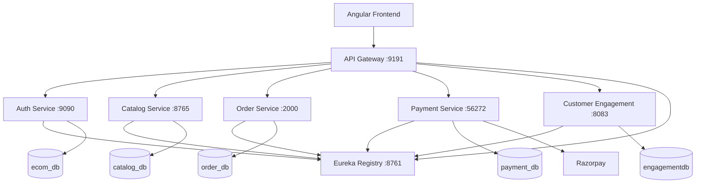

# RUNWAY

> A full-stack online shopping platform built with Angular and a Spring-based microservices architecture.

RUNWAY is an e-commerce application with a separate Angular frontend and a distributed Java backend. The backend is composed of an API Gateway, Eureka service registry, authentication, catalog, order, payment, and customer-engagement services. The services communicate through service discovery and expose REST APIs documented with OpenAPI/Swagger.

## ✨ Features

### Customer experience
- User signup and login
- JWT-based authentication
- Product browsing and category navigation
- Product search
- Product details
- Wishlist management
- Shopping cart
- Checkout and order placement
- Order history and order details
- Shipment tracking
- Product reviews and ratings
- Notifications
- Customer support tickets and ticket messages
- Account management

### Seller capabilities
- Seller dashboard
- Product management
- Product media/image management
- Category management
- Inventory management
- Seller-specific catalog views

### Admin / support capabilities
- Admin dashboard
- User administration and seller/support onboarding flows
- Notification template and notification-log management
- Support ticket management

### Backend capabilities
- Service discovery with Eureka
- Centralized routing through Spring Cloud Gateway
- JWT authentication and role-based access control
- MySQL persistence per service
- Flyway database migrations in services that use migrations
- OpenFeign-based inter-service communication
- Razorpay payment integration
- OpenAPI/Swagger documentation
- Actuator endpoints
- Automated unit/integration tests

---

## 🏗️ Architecture



### Request flow

```text
Angular Frontend
       │
       ▼
API Gateway :9191
       │
       ├── Auth / Admin
       ├── Catalog
       ├── Cart / Orders / Shipments
       ├── Payments
       └── Reviews / Ratings / Notifications / Tickets
              │
              ▼
       Eureka Service Registry
              │
              ▼
        Backend Services
```

The frontend communicates with the backend through `http://localhost:9191`. The gateway uses Eureka service discovery and load-balanced service names (`lb://...`) to route requests to the backend services.

---

## 🧩 Microservices

| Service | Port | Responsibility | Database |
|---|---:|---|---|
| **Service Registry** | `8761` | Eureka service discovery | — |
| **API Gateway** | `9191` | Central entry point and request routing | — |
| **Auth Service** | `9090` | Authentication, users, roles, admin operations | `ecom_db` |
| **Catalog Service** | `8765` | Products, categories, inventory, media, wishlist | `catalog_db` |
| **Order Service** | `2000` | Cart, orders, shipments | `order_db` |
| **Payment Service** | `56272` | Payment creation, confirmation and status handling | `payment_db` |
| **Customer Engagement** | `8083` | Reviews, ratings, notifications and support tickets | `engagementdb` |

---

## 🔐 Authentication & Security

RUNWAY uses JWT-based authentication with role-based access control.

The authentication service handles login/signup and JWT issuance. Protected backend services use Spring Security to validate authenticated requests and enforce role-based access.

Sensitive configuration is externalized through environment variables rather than committed as plaintext secrets.

Required variables include:

```text
DB_USERNAME
DB_PASSWORD
JWT_SECRET
RAZORPAY_KEY_ID
RAZORPAY_KEY_SECRET
CATALOG_UPLOAD_DIR
CATALOG_IMAGE_BASE_URL
ADMIN_USERNAME
ADMIN_EMAIL
ADMIN_PASSWORD
```

**Do not commit real values for these variables to Git.**

---

## 💳 Payments

The Payment Service integrates with Razorpay for payment processing.

Payment-related operations are routed through the API Gateway under:

```text
/payment/**
```

Razorpay credentials are supplied through environment variables:

```text
RAZORPAY_KEY_ID=<your-key-id>
RAZORPAY_KEY_SECRET=<your-key-secret>
```

---

## 📡 API Gateway Routes

The API Gateway runs on port `9191` and currently routes the following API groups:

| Route | Target service |
|---|---|
| `/auth/**`, `/admin/**` | Auth Service |
| `/catalog/products/**` | Catalog Service |
| `/catalog/inventory/**` | Catalog Service |
| `/catalog/categories/**` | Catalog Service |
| `/api/cart/**` | Order Service |
| `/api/orders/**` | Order Service |
| `/api/shipments/**` | Order Service |
| `/payment/**` | Payment Service |
| `/products/**` | Customer Engagement Service |
| `/reviews/**` | Customer Engagement Service |
| `/ratings/**` | Customer Engagement Service |
| `/notification-templates/**` | Customer Engagement Service |
| `/notification-logs/**` | Customer Engagement Service |
| `/tickets/**` | Customer Engagement Service |

---

## 🖥️ Frontend

The frontend is an Angular application using Angular `21.2.x`, TypeScript `5.9.x`, RxJS, and Tailwind CSS `4.2.x`.

The frontend contains dedicated flows/pages for:

- Home and informational pages
- Authentication
- Customer shopping
- Seller dashboard
- Admin dashboard
- Support dashboard
- Categories
- Product details
- Search
- Wishlist
- Cart
- Checkout
- Orders
- Shipment tracking
- Account
- Notifications
- Support tickets

The frontend API client uses the API Gateway as its backend base URL:

```text
http://localhost:9191
```

---

## 🛠️ Tech Stack

### Frontend
- Angular 21
- TypeScript
- RxJS
- Tailwind CSS
- HTML / CSS

### Backend
- Java
- Spring Boot
- Spring Cloud
- Spring Cloud Gateway
- Spring Cloud Netflix Eureka
- Spring Security
- Spring Data JPA
- OpenFeign
- OpenAPI / Swagger
- Spring Actuator

### Database & persistence
- MySQL
- Flyway

### Payments
- Razorpay Java SDK

### Build & development
- Maven
- npm
- Git / GitHub

---

## 📁 Project Structure

```text
RUNWAY/
│
├── runway_backend/
│   ├── api-gateway/
│   ├── auth-service/
│   ├── catalog-service/
│   ├── customer-engagement-service/
│   ├── order-service/
│   ├── payment-service/
│   └── service-registry/
│
├── runway_frontend/
│
└── .gitignore
```

---

## ⚙️ Prerequisites

Install the following before running the application locally:

- Java JDK compatible with the backend services
- Maven (or use the Maven Wrapper included with the services that provide it)
- MySQL 8.x
- Node.js
- npm
- Git

You also need a Razorpay test account/credentials if you want to exercise the payment flow.

---

## 🗄️ Database Setup

Create the databases used by the application:

```sql
CREATE DATABASE ecom_db;
CREATE DATABASE catalog_db;
CREATE DATABASE engagementdb;
CREATE DATABASE order_db;
CREATE DATABASE payment_db;
```

Configure the MySQL username and password through:

```text
DB_USERNAME
DB_PASSWORD
```

Flyway migrations included in the relevant services handle schema migrations when those services start.

---

## 🔧 Environment Configuration

Set the following environment variables before starting the backend:

```text
DB_USERNAME=<mysql-username>
DB_PASSWORD=<mysql-password>
JWT_SECRET=<long-random-jwt-secret>
RAZORPAY_KEY_ID=<razorpay-key-id>
RAZORPAY_KEY_SECRET=<razorpay-key-secret>
CATALOG_UPLOAD_DIR=<catalog-upload-directory>
CATALOG_IMAGE_BASE_URL=<catalog-image-base-url>
ADMIN_USERNAME=<initial-admin-username>
ADMIN_EMAIL=<initial-admin-email>
ADMIN_PASSWORD=<initial-admin-password>
```

For local development, `CATALOG_IMAGE_BASE_URL` should point to the catalog image endpoint exposed by the application, for example:

```text
http://localhost:8765/api/v1/catalog/images/
```

Do not copy production credentials into source control.

---

## ▶️ Running the Backend

Start the services in this general order so service discovery is available before the dependent services:

### 1. Eureka Service Registry

```powershell
cd runway_backend/service-registry
mvn spring-boot:run
```

Runs on:

```text
http://localhost:8761
```

### 2. Backend services

Start each service in a separate terminal:

```powershell
cd runway_backend/auth-service
mvn spring-boot:run
```

```powershell
cd runway_backend/catalog-service
mvn spring-boot:run
```

```powershell
cd runway_backend/customer-engagement-service
mvn spring-boot:run
```

```powershell
cd runway_backend/order-service
mvn spring-boot:run
```

```powershell
cd runway_backend/payment-service
mvn spring-boot:run
```

### 3. API Gateway

```powershell
cd runway_backend/api-gateway
mvn spring-boot:run
```

The gateway is available at:

```text
http://localhost:9191
```

> Keep each backend service running in its own terminal while developing locally.

---

## ▶️ Running the Frontend

From the frontend directory:

```powershell
cd runway_frontend
npm install
npm start
```

The Angular development server will normally be available at:

```text
http://localhost:4200
```

The frontend sends API requests through the API Gateway at `http://localhost:9191`.

---

## 📚 API Documentation

The backend services expose OpenAPI/Swagger documentation.

The API Gateway also provides an aggregated Swagger UI configuration.

After the backend is running, open:

```text
http://localhost:9191/swagger-ui/index.html
```

If the application is configured to expose the alternate SpringDoc path, the Swagger UI is also available from the gateway's configured Swagger route.

---

## 🧪 Testing

The backend services contain automated tests using the Spring testing stack, Mockito and service-specific test infrastructure.

Run tests from an individual service directory with Maven:

```powershell
mvn test
```

For example:

```powershell
cd runway_backend/auth-service
mvn test
```

The frontend also provides the standard Angular test command:

```powershell
cd runway_frontend
npm test
```

---

## 🔄 Development Workflow

A typical local development flow is:

```text
1. Start MySQL
        ↓
2. Start Eureka
        ↓
3. Start backend microservices
        ↓
4. Start API Gateway
        ↓
5. Start Angular frontend
        ↓
6. Open http://localhost:4200
```

All client-facing API traffic should go through the API Gateway rather than directly targeting individual backend services.

---

## 📌 Notes

- The project is configured for local development and uses localhost service endpoints.
- Each major backend domain has its own service and database.
- Secrets and environment-specific values are intentionally externalized.
- Catalog image storage uses a configurable local upload directory.
- Razorpay credentials are required only for payment functionality.

---

## 👨‍💻 Author

**Harsh Jaiswal**

Computer Science & Engineering | Full-Stack / Backend Development

GitHub: [HarshJaiswal497](https://github.com/HarshJaiswal497)

---

## 📄 License

No explicit open-source license is currently defined in the repository. If you intend others to reuse, modify, or distribute the project, add an appropriate `LICENSE` file and update this section.
